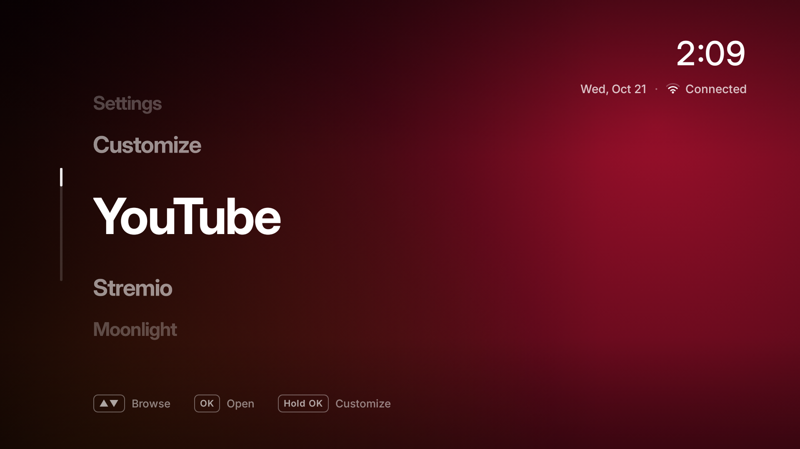

# Marquee for Android TV and Google TV

A minimal home screen for Android TV and Google TV. No ads, no content rows, no "recommended for
you": just your apps, in big type, on a background that takes its colours from the app you're on.



- Big app name, centre left. Up/Down cycles through your apps (it wraps around), OK opens one.
- The background is a soft glow in the selected app's brand colours, taken from its icon. Each one
  is pre-rendered once and cross-faded, so browsing stays smooth even on low-end TV chips.
- Top right: time, date and network (Wi-Fi band and link speed, or Ethernet).
- Hold OK (or press Menu) to **Customize**: OK shows or hides an app, move right to ▲ ▼ to reorder.
- **Settings** and **Customize** are always the last two entries.
- Holding Home opens a quick-settings bar with a sleep timer, Wi-Fi and All settings. On TCL TVs it
  opens TCL's own bar (picture mode, sound and so on) instead.
- On Google-made remotes, the YouTube and Netflix buttons open those apps.
- The default list is YouTube, Stremio, Moonlight, YouTube Music, Netflix and Play Store, whichever
  are installed. Everything else is one Customize away.
- Plain Java and framework views, no AndroidX or other libraries. The code is about 55 KB (most of
  the APK is the Inter font), so it starts instantly.

Requires Android TV 12 (API 31) or newer. Tested on a TCL C755 (Google TV, Android 14) and a
Chromecast with Google TV 4K (Android 14).

## Install

See **[docs/INSTALL.md](docs/INSTALL.md)**. In short: pair a computer with the TV over ADB, install
the APK, make Marquee the home app, and turn on the "Marquee Home button" helper if the stock home
screen keeps coming back.

## Optional speed tweaks

[`scripts/tune.sh`](scripts/tune.sh) sets the system animations to 0.5x and compiles YouTube ahead
of time for faster launches, and undoes both with one command. It works on any Android TV device
and isn't needed for Marquee. See [INSTALL.md](docs/INSTALL.md#optional-speed-tweaks).

## Build from source

`./build.sh` builds `build/marquee-launcher-debug.apk` without Gradle. It needs JDK 17+, `aapt`,
`dx`, `zipalign`, `apksigner` and an API 34 `android.jar`:

```sh
# Ubuntu / Debian
sudo apt install openjdk-17-jdk aapt dalvik-exchange zipalign apksigner
ANDROID_JAR=$ANDROID_HOME/platforms/android-34/android.jar ./build.sh
```

`ANDROID_JAR` defaults to `$ANDROID_HOME/platforms/android-34/android.jar`.

**Signing.** The APK is signed with `debug.keystore`, which `build.sh` creates if it is missing.
Keystores are git-ignored on purpose. Android only installs an update over an existing copy when
both are signed with the same key, so keep your keystore backed up and pass it with
`KEYSTORE=path/to/your.keystore ./build.sh` for every release. The CI workflow in
`.github/workflows/build.yml` (at the repository root) builds with a throwaway key, so its APK is for testing only.

**Tests.** `test/` has Robolectric tests that drive the home and Customize screens with D-pad keys
and save screenshots. Run `./build.sh` first, then `gradle -p test test -Dshots=build/shots`.

### Code map

| File | What it does |
| --- | --- |
| `MainActivity` | The home screen: app list, backdrop, clock and network status |
| `AppStore` | Finds TV apps, their colours, and the saved order and visibility |
| `Backdrop` | Pre-renders each app's glow background |
| `SettingsActivity` | The Customize screen |
| `HomeRedirectService` | Optional accessibility helper: takes Home back from the stock launcher, long-press Home, Config, YouTube and Netflix buttons, sleep timer |
| `QuickPanelActivity` | The quick-settings bar (or TCL's bar on TCL TVs) |
| `TvControls`, `SleepTimer`, `WifiIcon`, `Fonts` | Helpers for the bar and status line |

### Device-specific behaviour

Marquee runs the same everywhere, with two vendor touches that switch themselves off when they don't
apply:

- **TCL:** the quick-settings bar is TCL's own (a service in `com.android.tv.settings`). If it isn't
  there, Marquee shows its own bar.
- **Google remotes:** the YouTube and Netflix buttons are only handled for remotes with Google's
  USB vendor id (0x18d1) that aren't game controllers, so controller buttons in game-streaming apps
  are left alone.

## Privacy

Marquee has no internet permission, no analytics and no ads. It reads the list of installed apps
(to show them) and the Wi-Fi state (for the status line). The optional Home button helper is an
accessibility service. Android hands it key presses, and it acts only on Home, Config, YouTube and
Netflix, letting every other key through untouched. The only screen events it receives are from the
stock Google TV / Android TV home screen. It keeps no logs and sends nothing.

## License

MIT, see [LICENSE](../LICENSE). The Inter font is under the SIL Open Font License
([assets/fonts/OFL.txt](assets/fonts/OFL.txt)).
