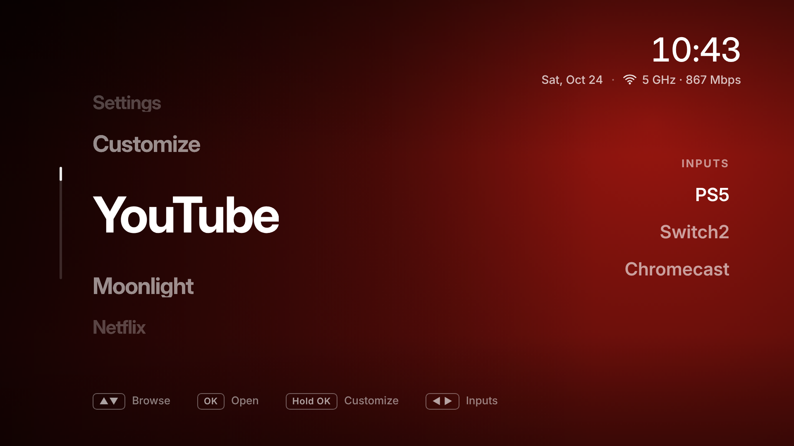

# Marquee for LG webOS

A minimal home screen for rooted LG TVs. No ads, no content rows: just your apps in big type, on a
background that takes its colours from the app you're on, with your HDMI inputs in their own column.

- Big app name, centre left. Up/Down cycles through your apps, OK opens one.
- **Inputs** column on the right: Right to move there, Up/Down to pick, OK to switch, Left or Back
  to return. Inputs show the device's own name (PS5, Chromecast...), and only plugged-in ones appear.
- Top right: time, date and network (Wi-Fi band and link speed, or Ethernet).
- Hold OK, or press the red or blue button, to **Customize**: show or hide apps and change their order.
- **Home button opens Marquee.** Pressing Home inside Marquee opens LG's home, so it's always one press away.
- **Opens when the TV turns on**, unless the TV turned on to an HDMI input (a console or Chromecast woke it over HDMI-CEC), which stays in front.
- Both of those are switches in Customize > Behaviour, and changes apply immediately.

## Requirements

- An LG TV **rooted with [Homebrew Channel](https://github.com/webosbrew/webos-homebrew-channel)**
  (see [rootmy.tv](https://rootmy.tv)), with **SSH enabled** in Homebrew Channel > Settings.
- A Mac or Linux computer on the same network, with `ssh` (built in on both).
- Tested on webOS 6.5.0 (firmware 03.51.16) with a Magic Remote. The app itself should run on
  webOS 4 and later.

## Install

1. Unzip this folder and open a terminal in it.
2. Run `sh install.sh` and type the TV's IP address when asked (TV Settings > Network). You can
   also pass it directly: `sh install.sh 192.168.1.10`.
3. Enter the TV's root password when SSH asks (twice). Homebrew Channel's default is `alpine`.

The installer installs the app, adds the background helper, and opens Marquee. Setting up the Home
button restarts LG's screen compositor once, so the picture goes black for a few seconds and the
open app closes. That also happens once each time the TV boots.

`sh install.sh --no-autostart` installs only the app, with no Home button or power-on changes.

## Uninstall

`sh uninstall.sh` (it asks for the IP too). It removes the helper and the app, and puts LG's Home
button back. Nothing else on the TV is changed by Marquee, so that's everything.

## How the Home button works, and its safeguards

webOS doesn't let apps replace the home screen. Marquee's helper (`tv/marquee-autostart`, installed to
`/var/lib/webosbrew/init.d/`, which Homebrew Channel runs at boot) does this:

1. It makes a copy of LG's Home key script, `/usr/lib/qt5/qml/KeyFilters/systemUi.js`, with 7 lines
   added: when Home would open LG's home and Marquee isn't in front, open Marquee instead. The copy is
   made on your TV from your TV's own file. No LG code ships in this package.
2. It lays the copy over the original with a bind mount and restarts the compositor. **LG's file is
   never modified**, and a reboot without the helper brings back LG's behaviour.

Safeguards:

- It only applies to the exact LG file it was written for (checked by SHA-256), and checks that its
  copy came out exactly as expected. On any other firmware it doesn't touch the file. Instead, it
  watches for LG's home opening and replaces it with Marquee, which shows LG's home for a moment.
- If the compositor isn't running 20 seconds after the restart, it undoes the change.
- If the TV restarts before that check passes, the change stays off from then on.
- If Marquee isn't installed, it does nothing, so Home can never end up doing nothing.
- To turn off just the Home change: `ssh root@TV 'touch /var/lib/webosbrew/marquee/qml-off'`, then reboot.

The helper's log is `/tmp/marquee-autostart.log` on the TV.

## Privacy

Marquee has no analytics and sends nothing anywhere. It reads the list of installed apps, the inputs
and the network status from the TV, and stores your app order on the TV.

## Build from source

- `./build.sh` builds `build/com.marquee.webos_<version>_all.ipk` from `app/` with plain `tar` and
  `python3` (`mkar.py` writes the `ar` archive the way webOS expects). No webOS SDK needed.
- `sh install.sh` also works straight from a checkout: it builds the app first.
- `./package.sh` builds the release zip, `build/marquee-webos-<version>.zip`.
- `app/preview.html` opens the home screen in a desktop browser, with sample apps from
  `preview/mock.js`.

The app is plain ES5 JavaScript and HTML, so it runs on the TVs' older browser engines.

## License

MIT, see [LICENSE](../LICENSE). The Inter font is under the SIL Open Font License
(`app/fonts/OFL.txt`).
